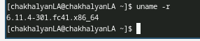
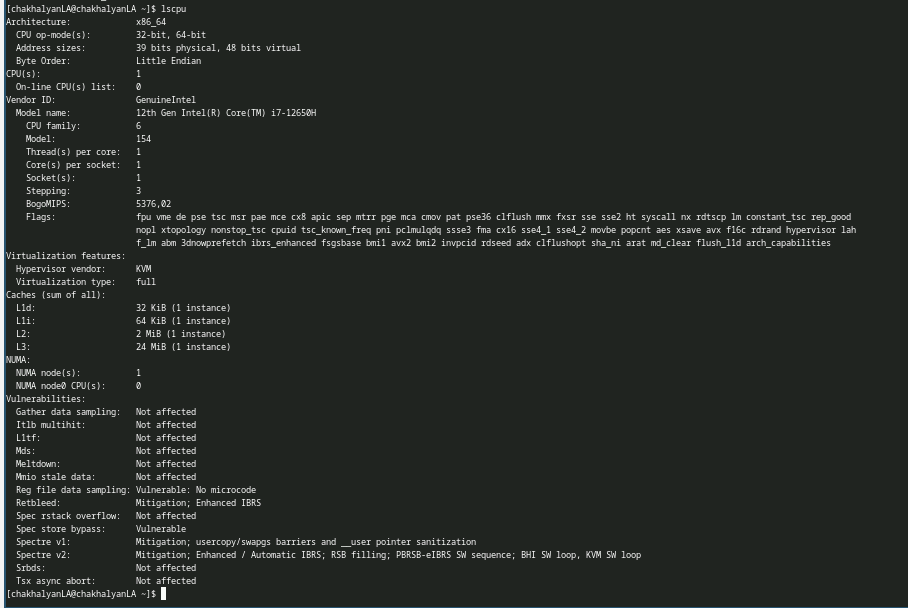
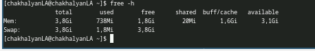
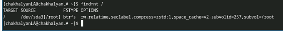
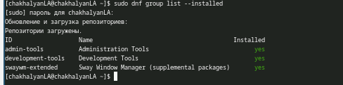
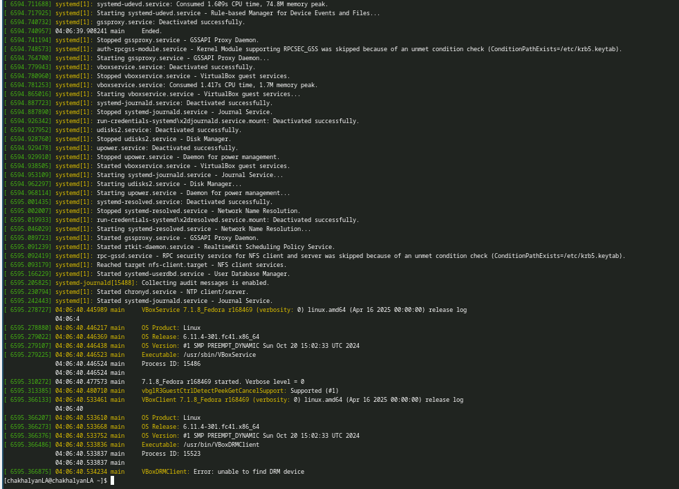

# Лабораторная работа № 1. Установка ОС Linux

**Выполнила:** Чахалян Лариса Арменовна  
**Операционная система:** Fedora Linux 41 (Sway)  
**Среда виртуализации:** Oracle VirtualBox  
**Дата фиксации результатов:** 10 октября 2026 г.

## 1. Цель работы

Установить и подготовить Linux в виртуальной машине, выполнить первоначальную настройку системы, ознакомиться с командами терминала и определить основные характеристики операционной системы.

## 2. Используемое программное обеспечение

- Хост-система: Windows 11.
- Среда виртуализации: Oracle VirtualBox.
- Гостевая система: Fedora Linux 41 с окружением Sway.
- Установочный образ: `Fedora-Sway-Live-x86_64-41-1.4.iso`.

## 3. Ход работы

### 3.1. Установка и первичная настройка

Fedora Linux была запущена в виртуальной машине Oracle VirtualBox. Для установки набора средств разработки была выполнена команда:

```bash
sudo dnf -y group install development-tools
```

Команда завершилась успешно. При проверке установленных групп пакетный менеджер отобразил группу `development-tools` со статусом `yes` (см. рисунок 5).

Для обновления системы первоначально использовалась команда:

```bash
sudo dnf -y update
```

Обновление не завершилось из-за ошибки загрузки пакета из репозитория Cisco OpenH264 (ответ сервера `403 Forbidden` и ошибка разрешения имени зеркала). После этого обновление было выполнено с отключением проблемного репозитория:

```bash
sudo dnf --disablerepo=fedora-cisco-openh264 upgrade
```

Транзакция завершилась со статусом `Ok` и сообщением `Complete!`. В ходе обновления был установлен более новый пакет ядра, однако на момент создания скриншотов продолжало работать ранее загруженное ядро `6.11.4-301.fc41.x86_64`. Для перехода на новое ядро необходима перезагрузка; в рамках зафиксированных результатов перезагрузка не подтверждена.

Также проверялась установка утилит `tmux` и `mc`:

```bash
sudo dnf -y install tmux mc
```

Пакеты уже были установлены, поэтому пакетный менеджер сообщил `Nothing to do`.

### 3.2. Определение версии ядра

Для определения версии запущенного ядра выполнена команда:

```bash
uname -r
```

Результат: `6.11.4-301.fc41.x86_64` (рисунок 1).

### 3.3. Информация о процессоре и виртуализации

Для получения характеристик процессора и среды виртуализации выполнена команда:

```bash
lscpu
```

По результатам вывода установлено:
- архитектура: `x86_64`;
- модель процессора, представляемая виртуальной машиной: `12th Gen Intel(R) Core(TM) i7-12650H`;
- число доступных виртуальных CPU: 1;
- производитель гипервизора: KVM;
- тип виртуализации: Full.

Команда фильтрации полей частоты `lscpu | grep -E 'Model name|CPU MHz|CPU max MHz|CPU min MHz'` показала модель процессора, но не показала значение частоты. Поэтому точная частота в отчёте не указывается, чтобы не подменять измерение предположением (рисунок 2).

### 3.4. Проверка оперативной памяти

Для просмотра использования оперативной памяти и swap выполнена команда:

```bash
free -h
```

В момент создания скриншота система показывала:
- всего оперативной памяти: 3,8 GiB;
- использовано: 738 MiB;
- свободно: 1,8 GiB;
- доступно: 3,1 GiB;
- swap: 3,8 GiB, использовано 0 B.

Показатели могут меняться в зависимости от запущенных процессов (рисунок 3).

### 3.5. Определение типа корневой файловой системы

Для проверки файловой системы корневого каталога выполнена команда:

```bash
findmnt /
```

Корневой каталог `/` расположен в источнике `/dev/sda3[/root]`. Тип файловой системы — `btrfs` (рисунок 4).

### 3.6. Проверка системного журнала

Для просмотра сообщений ядра использовалась команда:

```bash
sudo dmesg | less
```

В последующем выводе `sudo dmesg` видны записи о запуске и остановке системных служб, а также сообщения компонентов VirtualBox Guest Services. В журнале присутствует запись `VBoxDRMClient: Error: unable to find DRM device`. Она относится к графической подсистеме гостевой системы; сам факт наличия этой записи не позволяет сделать вывод о неработоспособности всей системы. Фрагмент журнала приведён на рисунке 6.

## 4. Результаты

| Параметр | Полученный результат |
|---|---|
| Дистрибутив | Fedora Linux 41 (Sway) |
| Запущенное ядро на момент снимка | `6.11.4-301.fc41.x86_64` |
| Архитектура | `x86_64` |
| Модель CPU | Intel Core i7-12650H, 12th Gen (модель, видимая виртуальной машине) |
| Виртуальные CPU | 1 |
| Гипервизор | KVM |
| Тип виртуализации | Full |
| Оперативная память | 3,8 GiB |
| Доступная память на момент снимка | 3,1 GiB |
| Swap | 3,8 GiB, использование 0 B |
| Корневая файловая система | Btrfs |
| Пакетная группа Development Tools | Установлена |
| tmux и mc | Уже установлены |

## 5. Ответы на контрольные вопросы

### 1. Что содержит учётная запись пользователя?

Учётная запись пользователя включает имя пользователя, числовой идентификатор UID, основной идентификатор группы GID, домашний каталог, командную оболочку и сведения о дополнительных группах, в которые входит пользователь.

### 2. Приведите примеры команд терминала и объясните их назначение.

- `man команда` — открыть руководство по команде.
- `cd /путь` — перейти в указанный каталог.
- `ls` — вывести содержимое каталога.
- `du -sh каталог` — показать суммарный размер каталога в удобном формате.
- `mkdir имя_каталога` — создать каталог.
- `rmdir имя_каталога` — удалить пустой каталог.
- `touch имя_файла` — создать пустой файл или обновить время его изменения.
- `rm имя_файла` — удалить файл.
- `chmod 755 имя_файла` — установить права доступа: владелец может читать, записывать и выполнять; группа и остальные пользователи — читать и выполнять.
- `history` — вывести историю команд текущей оболочки.

### 3. Что такое файловая система? Приведите примеры.

Файловая система — способ организации, хранения и поиска файлов и каталогов на носителе. Примеры файловых систем Linux: ext4, XFS и Btrfs. В исследованной системе для корневого каталога используется Btrfs.

### 4. Как посмотреть смонтированные файловые системы?

Можно использовать команды `mount`, `findmnt` и `df -h`. Команда `findmnt /` показывает источник и тип файловой системы для корневого каталога, а `df -h` отображает использование смонтированных файловых систем.

### 5. Как завершить зависший процесс?

Сначала процесс можно найти с помощью `ps aux` или `top`, затем завершить штатным сигналом командой `kill PID`, подставив идентификатор процесса. Если процесс не завершается, в крайнем случае можно использовать `kill -9 PID`. Принудительное завершение следует применять осторожно, поскольку процесс не сможет корректно выполнить завершающие действия.

## 6. Вывод

В ходе лабораторной работы была запущена Fedora Linux 41 в виртуальной машине Oracle VirtualBox, выполнена установка группы средств разработки и проверено наличие утилит `tmux` и `mc`. Изучены команды `uname`, `lscpu`, `free`, `findmnt` и `dmesg`. Получены сведения о версии запущенного ядра, процессоре, виртуализации, оперативной памяти и корневой файловой системе. Обновление было успешно выполнено с отключением репозитория Cisco OpenH264, загрузка пакетов из которого вызывала ошибку. Точное значение частоты CPU в доступном выводе не отображалось и поэтому не приводится.

## 7. Приложение. Скриншоты

### Рисунок 1 — Версия запущенного ядра



### Рисунок 2 — Характеристики CPU и виртуализации



### Рисунок 3 — Использование оперативной памяти



### Рисунок 4 — Корневая файловая система



### Рисунок 5 — Установленные группы пакетов



### Рисунок 6 — Фрагмент системного журнала


